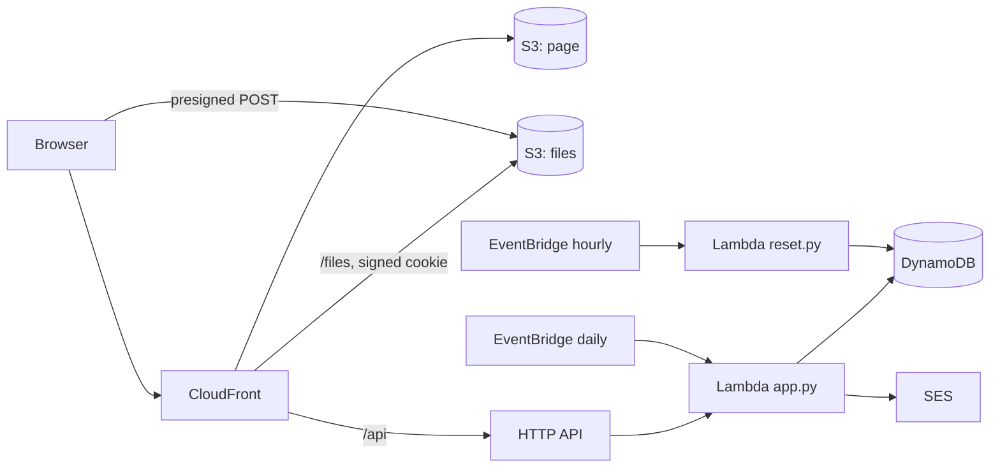

# Cars

A log of your cars, running serverless on AWS: charges and refuels, service, expenses and income of each car, with their receipts and photos, statistics (distance, the price of a kilometre, consumption per 100 km, costs by month and year, by station and category), a map of where it all happened, and reminders of what is due — on the page and by mail.

Everything is Terraform and AWS managed services: no servers, nothing running between requests, so an installation costs cents a month (see [Cost](#cost)).

## Demo

The address of the demo is the `site_url` output of its deployment: the summary of the latest run of the Actions workflow shows it.

Sign in with `demo@example.com` / `Demo-Password-1` (the fields are filled in for you).

The demo is English and made up: a Tesla Model 3 and a Volkswagen Touran that runs on gas (LPG) and petrol, two years of events around Berlin, their reminders. Everything on the page works: add, change and delete cars and events, receipts and photos, the statistics and the map, reminders, the imports and the export, API keys and share links. The demo user is an administrator, so the users are there to look at; changing them is not. The demo is public and goes back to its initial state **every hour**: the cars, events, files, keys and links are wiped, the examples of [`seed/seed.json`](seed/seed.json) are written again, dated back from the day of the reset, the demo password is put back and any other user is deleted. Changing the password and two-factor authentication are hidden in the demo, so no visitor can lock the others out, and it sends no mail.

## Features

- **Events** of a car: charges and refuels (quantity, unit price and total — a change of one of them counts the one of the other two that was filled in earliest; the price of the station's last refuel is filled in), service, expenses and income; odometer, category with its own list of choices, notes, "leave out of the statistics", receipts, photos and PDFs (also pasted with ⌘V / Ctrl+V), a place.
- **Fuels**: petrol, diesel, gas (LPG), methane (CNG, in kilograms) and electricity. A car on more than one, such as gas and petrol, gets the consumption per 100 km and the price of each fuel, and a chart of them.
- **Statistics** computed by the page: distance, kilometres a day, costs and costs less income, the price of a kilometre, a day and a month, consumption per 100 km, the average price of a kWh or a litre; charts by day, week, month or year with a shared crosshair (as in Grafana), zoom by selecting a stretch and a large view; shares of stations and categories; totals by year. An (i) on every tile tells what it is and its formula.
- **A map** of the events (Leaflet and OpenStreetMap) with an icon of their kind and groups of the near ones; the place of a new event comes from the browser or from a click on a map, and the station or service that was near is suggested, with its last price.
- **Reminders** after so many days, weeks, months or years and kilometres from the last event of their category, or on a day of every month, or on chosen days of the week, from a start date; "soon" and "overdue" on the page, and once a day by mail (production only).
- **Short forms** of each kind of event under links of their own, to keep on a phone; **drafts** of the forms in the browser, so a closed page loses nothing.
- **Import** of a backup of the Android app Car Expenses — refuels, expenses by pattern, income, odometer readings, reminders from the patterns with a period, the car, its photo and the photos of the expenses — and **export** of a car to a JSON file, with its receipts and photos, which imports again as a new car or into one, also into another account.
- **API keys** for programs (read, or read and write) and **share links** that open the cars, or one car, read only without a sign-in, each with where and when it was made and last used.
- **Account**: two-factor authentication (TOTP), password change; English, Russian, French and Italian; administrators invite and manage the users and may look at their cars.

## How it works



| Part | Service |
| --- | --- |
| Page | S3 and CloudFront |
| Sign-in | Cognito user pool, optional TOTP, group `admins` |
| API | API Gateway HTTP API with a Cognito JWT authorizer, and two routes without it — `/api/v1/…` for API keys and `GET /api/share/…` for share links — that the Lambda checks itself |
| Data | DynamoDB, one table, a partition per user (`pk = USER#<email>`) |
| Receipts and photos | a private bucket under `files/<hash of the user>/`, read through CloudFront with a signed cookie for that folder only |
| Reminders | EventBridge once a day, mails through SES (production) |
| Reset | EventBridge every hour, `lambda/reset.py` (the demo) |

| Path | What is there |
| --- | --- |
| `*.tf` | Terraform |
| `web/` | The page: `index.html`, `app.js`, `stats.js` (the statistics), `charts.js` (SVG charts), `i18n.js` (the texts), `styles.css`, `config.js.tftpl` |
| `lambda/app.py` | The API, the imports and the daily reminders |
| `lambda/access.py` | API keys and share links |
| `lambda/carexpenses.py` | The import of Car Expenses backups |
| `lambda/reminders.py`, `lambda/mail.py`, `lambda/files.py`, `lambda/common.py` | When a reminder is due, its mails, the files and signed cookies, the table and the AWS clients |
| `lambda/reset.py`, `seed/seed.json` | The hourly reset of the demo and its examples |
| `lambda/*_test.py`, `lambda/fakes.py` | Tests and the AWS services they fake |

## Demo and production

The defaults of [`variables.tf`](variables.tf) are the public demo:

- the page answers at its `*.cloudfront.net` address with CloudFront's certificate, and no DNS is touched;
- no SES identity and no mails;
- the sign-in is published and filled in (`demo = true`), password change and two-factor authentication are hidden, and the administration is read-only;
- the hourly reset (`reset_schedule`) rebuilds everything from `seed/seed.json`;
- point-in-time recovery is off, and the buckets are deleted with their content on `terraform destroy`.

**Production** starts from [`examples/production.tfvars`](examples/production.tfvars):

| Variable | Demo (default) | Production |
| --- | --- | --- |
| `name` | `cars-serverless` | `cars` — the prefix of every resource |
| `demo` | `true` | `false` |
| `domain_name`, `route53_zone_name` | `""` — the CloudFront address | `cars.example.com`, `example.com` |
| `sender_address` | `""` — no SES, no mails | `alert@cars.example.com` — mails the reminders |
| `admin_email` | `demo@example.com` | your address |
| `admin_password` | `Demo-Password-1` | `""` — Cognito mails a temporary password |
| `reset_schedule` | `rate(1 hour)` | `""` — no reset, no examples |

Pick a fresh `name` (and state key): production is a separate deployment, not a change of the demo. The domain needs a public Route 53 zone in the same account, where the stack validates the certificate, writes the alias records and the records of the SES identity. While the SES account is in the sandbox, mails reach verified addresses only.

## Deploy

### What you need

1. An S3 bucket for Terraform state (the S3 backend with the native lockfile, Terraform 1.10+).
2. The GitHub OIDC provider in the AWS account and a role for this repository that trusts only jobs of the GitHub environment `demo`. Its permissions: everything named with the `name` prefix (`s3:*` on `arn:aws:s3:::cars-serverless-*`, the table, functions, roles with `iam:PassRole`, log groups, SSM parameters, EventBridge rules), API Gateway, Cognito and CloudFront (their ids are generated), log delivery for API access logs, and the state objects under the state key prefix. The demo needs no ACM, Route 53 or SES; production adds them.
3. In the GitHub repository: the environment `demo`, and the variables `AWS_ROLE_ARN` (the role) and `TF_STATE_BUCKET` (the state bucket). There are no secrets.

### GitHub Actions

[`.github/workflows/terraform.yml`](.github/workflows/terraform.yml) only calls the shared workflow of [Tozapid/demo-ci-cd-skeleton](https://github.com/Tozapid/demo-ci-cd-skeleton):

- every push and pull request: `terraform fmt` and `terraform validate`; the Lambda tests; the page's syntax check;
- pull requests from this repository: `terraform plan` in the environment `demo`;
- a push to `main` or a manual run: plan and apply in the environment `demo`. The job stops if the plan would destroy or replace a bucket, the table or the user pool;
- after `main` is deployed: the GitHub release of the newest `CHANGELOG.md` entry, once.

The jobs get AWS credentials from GitHub's OIDC token: no AWS key is stored anywhere.

### Versions and releases

Every entry of [`CHANGELOG.md`](CHANGELOG.md) starts with its version (`## v0.1.0`, optionally ` — ` and a date or a title), with the changes under `### Added`, `### Changed`, `### Fixed` and `### Security`, newest first. The site takes its version from the newest entry when Terraform deploys it, and the release job makes it a tag and a GitHub release. Settings → Version reads the releases of `releases_repository` and shows those after the version of the site.

### From a workstation

```bash
terraform init \
  -backend-config="bucket=<state bucket>" \
  -backend-config="key=cars-serverless-aws/terraform.tfstate" \
  -backend-config="region=eu-central-1"
terraform apply                                   # the demo
terraform apply -var-file=terraform.tfvars        # production, see above
```

## Access and security

- `/api/*` takes a Cognito token (JWT authorizer); the Lambda also wants a verified email in it, and users cannot change their email. Each user sees and changes only their own cars; an administrator may read the cars of the others, never change them.
- `/api/v1/…` takes an API key (`Authorization: Bearer cars_…` or `X-Api-Key`); only its SHA-256 is kept, so a key is shown once. `GET /api/share/<token>/…` opens what a share link allows, read only. Both routes skip the JWT authorizer, and the Lambda checks the key or the token before anything else.
- Receipts and photos are private: every answer of the API sets a CloudFront signed cookie for one hour that opens only the files of that user, and the files are served with `Content-Security-Policy: sandbox`; a PDF downloads.
- The page builds its DOM itself, and its content security policy allows scripts only from itself, two pinned jsDelivr packages and the pinned Leaflet of cdnjs, with subresource integrity; the map tiles come from OpenStreetMap, which gets the origin of the site as the referrer and nothing more.

## Tests

```bash
cd lambda && python3 -m unittest discover -p '*_test.py'
for f in web/*.js cloudfront/*.js; do node --check "$f"; done
```

The tests touch no network: DynamoDB, S3, SES, SSM and Cognito are faked (`lambda/fakes.py`).

## Cost

Lambda, DynamoDB on demand, the HTTP API, CloudFront, Cognito, EventBridge and SES are in their free tiers or cents; receipts in S3 are megabytes. No WAF: a WebACL alone costs about five dollars a month.

## License

[MIT](LICENSE)
