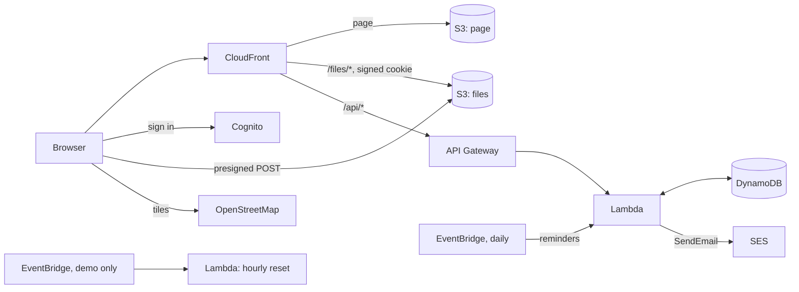

# Cars

A log of your cars, running serverless on AWS: every charge and refuel, service, expense and income of each car, with its receipts, photos and place, the statistics of what a car costs and burns, a map of where it all happened, and reminders of what is due — on the page and by mail.

Everything is Terraform and AWS managed services: no servers, nothing running between page views and the daily look at the reminders, so an installation costs cents a month (see [Cost](#cost)).

## Why

**What a car really costs.** A kilometre is not the price of a litre: insurance, tax, tyres, the garage and the car wash count too, and income such as a lift paid for or a yearly quota of an electric car takes some back. Every tile of the statistics says how it is counted — an (i) next to it shows the formula — and a purchase or a repair of a former owner can be left out of the statistics with one checkbox and still count for the odometer.

**Gas and petrol, or a charger at home and on the road.** A car that runs on more than one fuel gets the consumption per 100 km and the price of each: gas (LPG), petrol, diesel, methane (in kilograms) and electricity. The station a refuel was made at is a category of its own, with its share of the money and of the litres or kWh.

**Fast to fill in, also on a phone.** Each kind of event has a short form under a link of its own. The place comes from the browser, and the station that was there last time is filled in with its last price; of quantity, unit price and total, two give the third. A form keeps a draft in the browser until it is saved, and a receipt goes in with ⌘V / Ctrl+V.

## Demo

**<https://d1idny8s5itdi6.cloudfront.net>**

Sign in with `demo@example.com` / `Demo-Password-1` (the fields are filled in for you).

The demo is English and made up: a Tesla Model 3, charged at home, at work and on the motorway, and a Volkswagen Touran that runs on gas and petrol, with two years of events around Berlin and their reminders. The demo has **no mail**: the reminders that are due show on the page only. Everything else works: add, change and delete cars, events, receipts and photos, the statistics, the charts and the map, reminders, the imports and the export, API keys and share links. The demo user is an administrator, so the users are there to look at; changing them is not. The demo is public and goes back to its initial state **every hour**: the cars, events, files, API keys and share links are wiped, the examples of [`seed/seed.json`](seed/seed.json) are written again, dated back from the day of the reset so the demo always looks recent, the demo password is put back and any other user is deleted. Changing the password and two-factor authentication are hidden in the demo, so no visitor can lock the others out.

## Features

- **Cars**: name, make, model, year, VIN, number plate, energy (kWh or litres), currency, a photo opened full size on a click, notes, sold; every user has cars of their own.
- **Events**: charges and refuels (quantity, unit price and total — a change of one counts the one of the other two that was filled in earliest; the station's last price is filled in), service, expenses and income; date and time, odometer, a category with its own list of choices, the fuel, notes, receipts, photos and PDFs (photos shrunk to 2000 pixels by the browser, also pasted from the clipboard), "leave out of the statistics", a place.
- **Statistics** for 12 months, a year or all the time: distance and kilometres a day, costs and costs less income, the price of a kilometre, a day and a month, consumption per 100 km and the average price of a kWh or a litre — of each fuel when there are several —, shares of stations and categories, totals by year, every tile with an (i) and its formula.
- **Charts** of costs, kilometres, the odometer, consumption and the price of a kilometre by day, week, month or year, with a crosshair shared across them (as in Grafana), zoom by selecting a stretch, a large view, and series hidden or shown alone from the legend.
- **A map** of the events (Leaflet and OpenStreetMap), with an icon of their kind and the near ones grouped; a table of the places. The place of an event comes from the browser or from a click on a map, and the categories used near it come first.
- **Reminders** after so many days, weeks, months or years and kilometres from the last event of their category, on a day of every month, or on chosen days of the week, from a start date; "soon" and "overdue" on the page and once a day by mail.
- **Short forms** of each kind of event under links of their own, for a phone: the link icon in the title of a new event's form; added to the home screen, a short form opens itself (it links a manifest of its own, made by `cloudfront/manifest.js`); **drafts** of every form in the browser.
- **Import and export** from two menus next to "Add a car": import of a backup of the Android app Car Expenses or of a JSON file, as new cars or into a chosen one; export of a car to a JSON file with its receipts and photos, which imports again, also into another account, or of its events to CSV.
- **Without a network**: the page installs on a phone (PWA), opens with the data last loaded, and keeps new events with their files in a queue of the browser until the network is back.
- **API keys** for programs, read or read and write, and **share links** that open the cars, or one car, read only without a sign-in, for a time or for good; each tells where and when it was made and last used.
- **Administrators** invite and manage the users, and may look at their cars, read only.
- **Version**: Settings → Version shows the version of the site and the releases of this repository that came after it.
- **Account**: two-factor authentication with an authenticator app (TOTP), password change; the page and the mails in English, Russian, French and Italian.

## How it works



| Part | Service |
| --- | --- |
| Page | S3 + CloudFront, on its own domain or on the `*.cloudfront.net` address |
| Sign-in | Cognito user pool, no self sign-up, optional TOTP; group `admins` |
| API | API Gateway HTTP API with a Cognito JWT authorizer, Lambda `lambda/app.py` (Python, arm64); two routes without the authorizer for API keys and share links, checked by the Lambda |
| Data | DynamoDB on demand, one table, a partition per user: cars, events, reminders, API keys, share links |
| Files | a private S3 bucket under `files/<user>/`, uploaded by the browser through a presigned POST and served by CloudFront with signed cookies for that prefix only |
| Reminders | EventBridge once a day (`reminder_schedule`) wakes the same Lambda, which mails each user the reminders that became due (production) |
| Demo reset | Lambda `lambda/reset.py`, EventBridge `rate(1 hour)` |

### Statistics

The page loads every event of a car and counts the statistics itself (`web/stats.js`), so changing the period, the step of the charts or the fuel shown costs no request:

- the costs are the charges and refuels, the service and the expenses; "less income" takes the income off;
- the distance of a period is its highest odometer less the last odometer before it (or its lowest without one); a day is the time from its first to its last event, a month 30 days;
- an event left out of the statistics counts for the odometer only, and only between the first and the last counted event, so an old repair of a former owner neither opens the charts years earlier nor adds its kilometres;
- the consumption of a fuel is its quantity over the whole distance: which kilometres went on which fuel is not known, so the fuels together make the consumption of the car. A refuel without a fuel gets it from the name of its station ("LPG", "gas" and "propane" are gas, "diesel" diesel, "CNG" methane), else from the energy of the car.

### Reminders

A reminder names a category of events, such as "Inspection" or "Insurance", and counts from the last event of that category of any kind. "Every so long" is due that many days, weeks, months or years (calendar ones) and that many kilometres after it, whichever comes first; "on a day of the month" (the 31st is the last day of a shorter month) and "on days of the week" are due on the first such day after it. A start date holds a reminder back until then. A reminder is "soon" `reminder_lead_days` (14) days or `reminder_lead_km` (1000) km before it is due — a day before for a weekly one, three for a monthly one — and "overdue" after. The daily job mails each user one message with the reminders that became soon or overdue since the last one, in the language of their page.

### Imports and export

- **Car Expenses** (Android): a backup has the text of every table and the photos of the expenses in base64, tens of megabytes. The page cuts the photos out, sends the text (about 100 KB) to the API, and uploads the photos of the events that are new itself. Refuels keep their fuel type as the station; a record with only the odometer is an event "Пробег" left out of the statistics; an expense of several patterns is an event per pattern; the patterns with a period become reminders; the car gets its make, model, VIN, year, photo, purchase and sale. Leva can be converted to euro.
- **JSON** (`format: "cars-serverless-aws"`): a car, its events and reminders as the API gives them, and its receipts and photos in base64 if asked; an import keeps the ids of the events, so importing a file twice adds nothing twice, and uploads the files anew under the importing user.

- **CSV**: every event of a car, a column per field, dates as written, a point in the numbers; export only.

Both imports find an event by its fields, so an import adds only what is new and leaves events changed on the page as they are.

### Without a network

A service worker (`web/sw.js`) keeps the page and the sign-in libraries (cache `cars-shell-v<N>`, raised when the list changes) and the last answers of the API to reads (`cars-data-v1`). A request goes to the network first; without one the saved answer comes back marked `x-offline`, and the page tells the time of its data. Writes are never cached.

A new event saved without a network waits in IndexedDB (`cars-offline`, `outbox`) with its receipts and photos, marked ⏳ in the list. The page names the event itself (16 hex characters), and `POST /api/cars/<id>/events` with a known id answers with the event already saved, so sending it again does not make it twice. The queue goes when the network is back, when the tab is shown again and every 30 seconds: the files first, then the event. With an expired session the reads come from the cache and the queue waits for the next sign-in. Signing out clears the queue and the cached data, asking first if events wait; changing or deleting older events needs a network.

### Without a sign-in

- An **API key** (`cars_<id>_<secret>`) acts for its user on `/api/v1/cars…` through `Authorization: Bearer <key>` or `X-Api-Key`; a read key only reads. Only the SHA-256 of a key is kept, so it is shown once.
- A **share link** (`/#s/<token>/…`) opens the cars of its user, or one car, read only, with every tab of the page, through `GET /api/share/<token>/…`; it may expire, and deleting it closes it at once.
- Both remember where and when they were made and last used (the address of the visitor in front of CloudFront, the browser or program) and how often.

## Test environment and production

The defaults deploy the **test environment**, the public demo above. It is the same code with mail turned off:

- no domain: the page answers at its `*.cloudfront.net` address with CloudFront's certificate, and no DNS is touched;
- no SES identity and no mails;
- the sign-in is published and filled in (`demo = true`), password change and two-factor authentication are hidden, and the administration is read-only;
- the hourly reset (`reset_schedule`) rebuilds everything from `seed/seed.json`;
- point-in-time recovery is off, and the buckets are deleted with their content on `terraform destroy`.

**Production** turns mail on with a domain and a sender address. Start from [`examples/production.tfvars`](examples/production.tfvars):

| Variable | Test environment (default) | Production |
| --- | --- | --- |
| `name` | `cars-serverless` | `cars` — the prefix of every resource |
| `demo` | `true` | `false` |
| `domain_name`, `route53_zone_name` | `""` — the CloudFront address | `cars.example.com`, `example.com` |
| `sender_address` | `""` — no SES, no mails | `alert@cars.example.com` — mails the reminders |
| `admin_email` | `demo@example.com` | your address |
| `admin_password` | `Demo-Password-1` | `""` — Cognito mails a temporary password |
| `reset_schedule` | `rate(1 hour)` | `""` — no reset, no examples |

Steps to production:

1. Pick a fresh `name` (and state key): production is a separate deployment, not a change of the demo.
2. The domain needs a public Route 53 zone in the same account (`route53_zone_name`): the stack validates the certificate there and writes the alias records.
3. With `sender_address` the stack makes `domain_name` an SES identity (`ses.tf`): Easy DKIM, a MAIL FROM domain `mail.<domain_name>` and DMARC, in the same zone. SES verifies it a few minutes after the apply. While the SES account of the region is in the sandbox, mails reach only verified addresses; request production access in the SES console to lift it.
4. Sign in with the temporary password Cognito mails to `admin_email`. Invite the others in Settings → Users.

## Deploy

### What you need

1. An S3 bucket for Terraform state (the S3 backend with the native lockfile, Terraform 1.10+).
2. The GitHub OIDC provider in the AWS account and a role for this repository that trusts only jobs of the GitHub environment `demo`. Its permissions: everything named with the `name` prefix (`s3:*` on `arn:aws:s3:::cars-serverless-*`, the table, functions, roles with `iam:PassRole`, log groups, SSM parameters, EventBridge rules), API Gateway, Cognito and CloudFront (their ids are generated), log delivery for API access logs, and the state objects under the state key prefix. The demo needs no SES, ACM or Route 53; production adds them.
3. In the GitHub repository: the environment `demo`, and the variables `AWS_ROLE_ARN` (the role) and `TF_STATE_BUCKET` (the state bucket). There are no secrets. Optionally `ACCESS_LOGS_BUCKET`: the CI passes it as `access_logs_bucket`, and the CloudFront access logs of the site go there (see [Access logs](#access-logs)); the role then also needs log delivery in `us-east-1` (`logs:PutDeliverySource`, `PutDeliveryDestination`, `CreateDelivery` and their `Get`/`Delete`/`Describe` on names with the prefix) and `s3:GetBucketPolicy` on that bucket.

### GitHub Actions

[`.github/workflows/terraform.yml`](.github/workflows/terraform.yml) only calls the shared workflow of [Tozapid/demo-ci-cd-skeleton](https://github.com/Tozapid/demo-ci-cd-skeleton):

- every push and pull request: `terraform fmt` and `terraform validate`; the Lambda tests; the page's syntax check;
- pull requests from this repository: `terraform plan` in the environment `demo`;
- a preview of a pull request, by hand: Run workflow with `preview` = its number deploys its last push once more as `cars-serverless-pr<number>`, with its own state, and comments the address on it; it is destroyed when the pull request is merged or closed, by hand (`destroy`), or by the daily sweep, which also takes those not deployed for a week;
- a push to `main` or a manual run: plan and apply in the environment `demo`. The job stops if the plan would destroy or replace a bucket, the table or the user pool. A manual run from another branch deploys that branch over the same site until `main` is deployed again;
- after `main` is deployed: the GitHub release of the newest `CHANGELOG.md` entry, once.

The jobs get AWS credentials from GitHub's OIDC token: no AWS key is stored anywhere.

### Versions and releases

Every entry of [`CHANGELOG.md`](CHANGELOG.md) starts with its version, optionally followed by a date or a title (`## v0.2.0`, `## v0.2.0 — 2026-11-01`), with the changes under `### Added`, `### Changed`, `### Fixed` and `### Security`, newest first. The site takes its version from the newest entry when Terraform deploys it, and the release job makes it a tag and a GitHub release. Settings → Version reads the releases of `releases_repository` from the Atom feed of the GitHub releases and keeps them an hour.

### From a workstation

```bash
terraform init \
  -backend-config="bucket=<state bucket>" \
  -backend-config="key=cars-serverless-aws/terraform.tfstate" \
  -backend-config="region=eu-central-1"
terraform apply                                   # the test environment
terraform apply -var-file=terraform.tfvars        # production, see above
```

## API

The page uses the same API as a program does; with a key, the paths start with `/api/v1` instead of `/api`, and reach the cars only.

| Path | What it does |
| --- | --- |
| `GET /api/cars`, `POST /api/cars` | The cars with the day of their last event and their number of events; a new car |
| `GET`, `PUT`, `DELETE /api/cars/<car>` | One car; a deleted car takes its events, reminders and files along |
| `GET`, `POST /api/cars/<car>/events` | The events of a car; a new one |
| `PUT`, `DELETE /api/cars/<car>/events/<event>` | One event |
| `GET`, `POST /api/cars/<car>/reminders`, `PUT`, `DELETE /api/cars/<car>/reminders/<reminder>` | The reminders with their state |
| `POST /api/cars/<car>/import/carexpenses`, `POST /api/cars/<car>/import/json` | The imports |
| `POST /api/files` | Where the browser uploads a file to (a presigned POST) |

```bash
curl -H "Authorization: Bearer cars_…" https://<site>/api/v1/cars
curl -X POST -H "Authorization: Bearer cars_…" -H "Content-Type: application/json" \
  -d '{"kind":"refuel","date":"2026-10-19T08:30","quantity":30,"price":0.35,"fuel":"electric"}' \
  https://<site>/api/v1/cars/<car>/events
```

## Access logs

Off by default. With `access_logs_bucket` set (the repository variable `ACCESS_LOGS_BUCKET` in CI), `access-logs.tf` turns on the standard logs (v2) of CloudFront: CloudWatch delivers a gzipped JSON line per request from `us-east-1` to `cloudfront/<name>/<yyyy>/<MM>/<dd>/` of that bucket, at no charge for the delivery to S3. A line holds the date and time, the address and country of the viewer, the method, path, status, bytes, time taken, referrer, user agent, cache result and host. The files bucket also writes S3 server access logs there, under `s3/` partitioned by the date of the request.

The bucket is yours, in the same account: its policy has to let `delivery.logs.amazonaws.com` put objects under `cloudfront/` (and read the bucket ACL) and `logging.s3.amazonaws.com` under `s3/`, conditioned on the account. [account-serverless-aws](https://github.com/Tozapid/account-serverless-aws) reads such a bucket and shows the traffic of each site.

## Access and security

- `/api/*` takes only a Cognito token (JWT authorizer); the Lambda also wants a verified email in it, and users cannot change their email (the client writes `locale` only).
- Each user sees and changes only their own cars. Administrators are the members of the Cognito group `admins`, read from the `cognito:groups` claim of the token; they may read the cars of the others (`?owner=<email>`), never change them.
- `/api/v1/…` and `GET /api/share/…` skip the authorizer; the Lambda checks the API key or the token of the link before anything else, and a key or a link reaches the cars of its user only.
- Receipts and photos are private: every answer of the API sets a CloudFront signed cookie for one hour that opens only the files of that user, the files are served with `Content-Security-Policy: sandbox`, and a PDF downloads.
- The page bucket is private, read only by the distribution; responses of `/api/*` are never cached.
- The page builds its DOM itself, and its content security policy allows scripts only from itself, two pinned jsDelivr packages and the pinned Leaflet of cdnjs, with subresource integrity; the map tiles come from OpenStreetMap, which gets the origin of the site as the referrer and nothing more.
- The Lambda may send mail only from `sender_address`.

## Tests

```bash
cd lambda && python3 -m unittest discover -v -p '*_test.py'
for f in web/*.js cloudfront/*.js; do node --check "$f"; done
```

The tests use no network: DynamoDB, S3, SES, SSM and Cognito are faked (`lambda/fakes.py`). The reset is tested end to end through the API: every example of `seed/seed.json` must pass the checks of the API.

## Cost

| Service | Test environment (demo) | Production, light use* |
| --- | --- | --- |
| Lambda, EventBridge, API Gateway, Cognito, CloudFront | free allowances | free allowances |
| DynamoDB on demand, S3, CloudWatch Logs | a few cents | a few cents |
| SES | — | $0.10 per 1,000 messages |
| **Total** | **cents a month** | **under $1 a month** |

\* A handful of users and cars, a few events a day and receipts of a few megabytes. A WAF web ACL is left out on purpose: it alone would cost about $5–6 a month. Prices change; check the AWS pricing pages for your region.

## Repository

| Path | What it is |
| --- | --- |
| `lambda.tf`, `iam.tf`, `lambda/app.py` | The function of the API, the imports and the reminders, its permissions and code |
| `lambda/access.py` | API keys and share links |
| `lambda/carexpenses.py` | The import of Car Expenses backups |
| `lambda/reminders.py`, `lambda/mail.py` | When a reminder is due, and its mails |
| `lambda/files.py`, `lambda/common.py` | Uploads and signed cookies; the table, the AWS clients |
| `apigateway.tf`, `cognito.tf` | The API and the users |
| `dynamodb.tf`, `s3.tf` | The table, the page and file buckets |
| `cloudfront.tf`, `cloudfront/`, `dns.tf`, `frontend.tf`, `web/` | The distribution, the domain, the page, its statistics (`stats.js`), charts (`charts.js`), translations (`i18n.js`) and offline side (`sw.js`, `manifest.json`) |
| `ses.tf` | The SES identity of `domain_name` for the reminders (production with `sender_address`) |
| `reset.tf`, `lambda/reset.py`, `seed/seed.json` | The hourly reset of the demo and its examples |
| `examples/production.tfvars` | A starting point for production |

## Limitations

- Which kilometres went on which fuel is not recorded, so the consumption of each fuel counts over the whole distance of the car.
- The map tiles are those of the volunteer-run servers of OpenStreetMap, meant for light use; a busy installation needs a tile service of its own.
- Car Expenses has no documented backup format; the import reads the backups of version 30 of the app.
- Two-factor authentication is TOTP only; a lost authenticator is reset by an administrator or in the Cognito console.

## License

[MIT](LICENSE)
